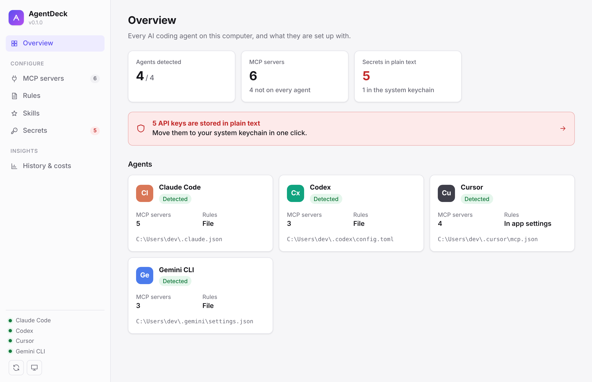
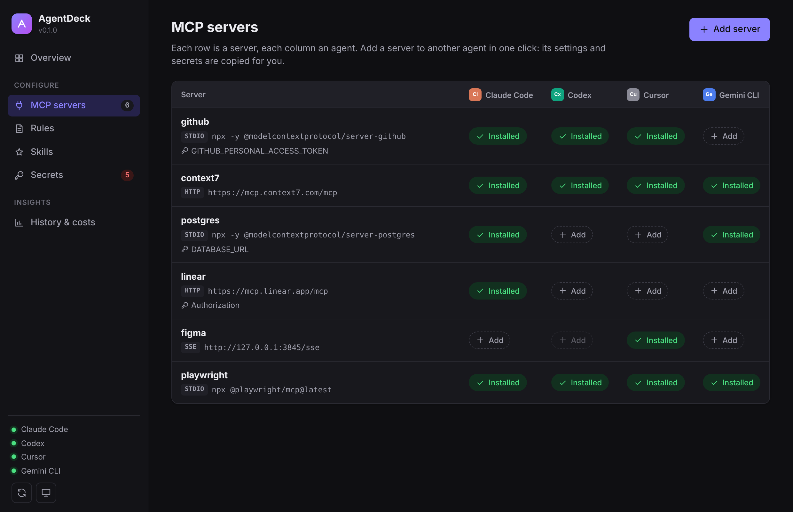
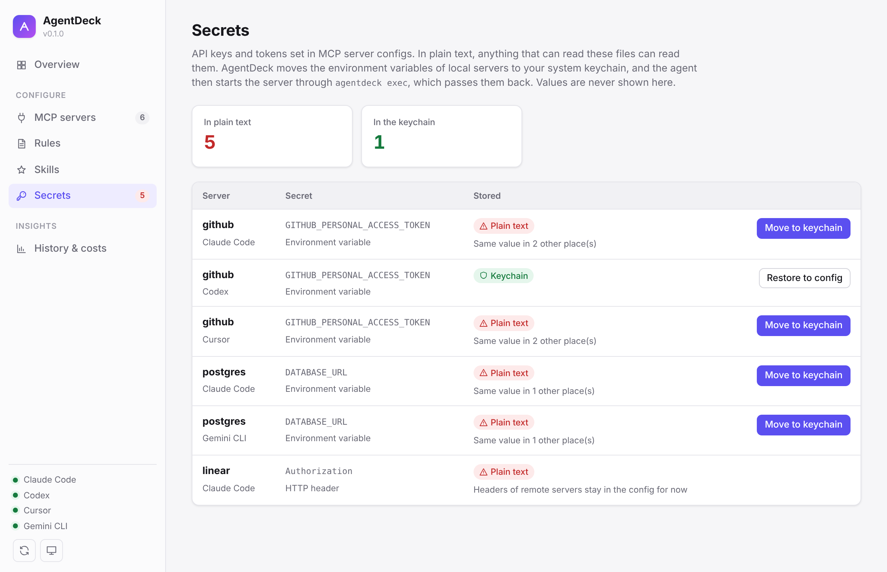
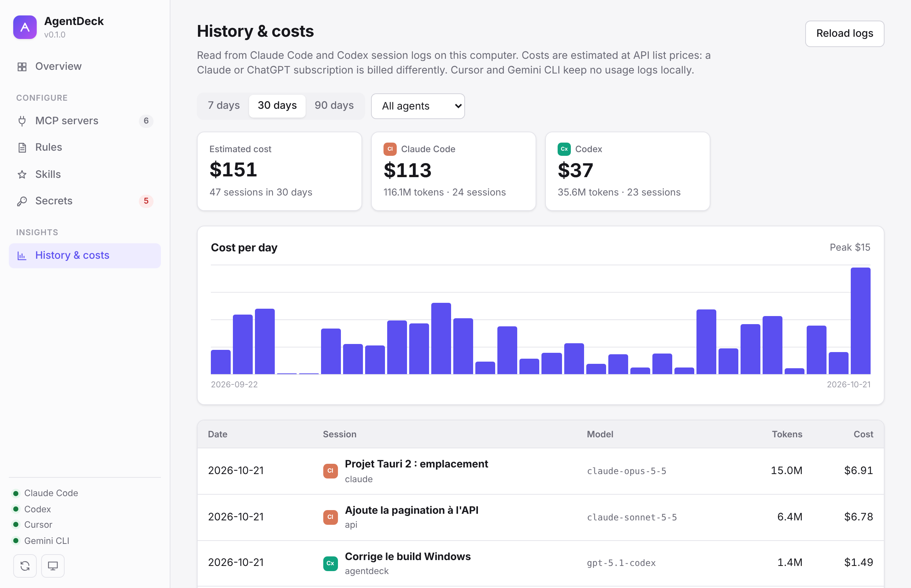
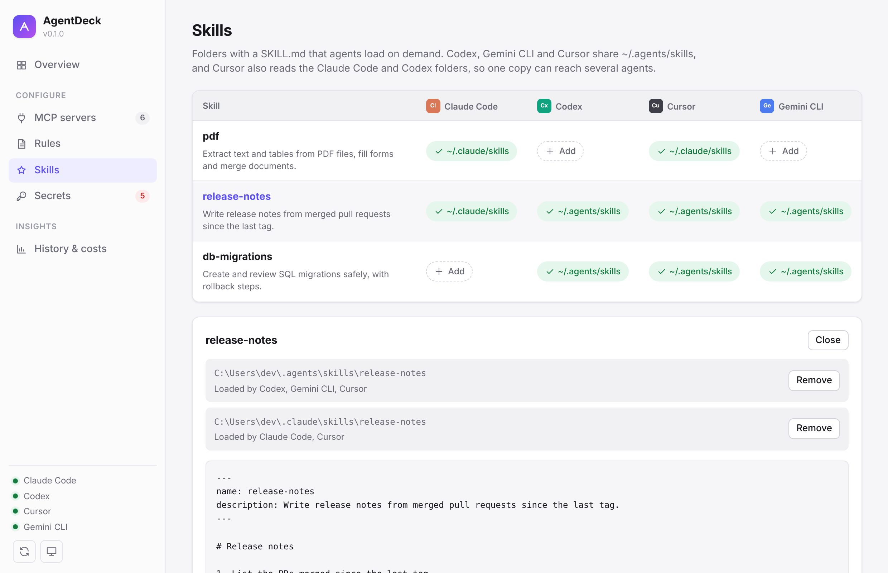

# AgentDeck

**One control center for all your AI coding agents.** AgentDeck manages the MCP
servers, rules, skills and secrets of Claude Code, Codex, Cursor and Gemini CLI
in one desktop app, and shows what your sessions cost.

Runs on Windows, macOS and Linux. Local only: no account, no telemetry,
nothing leaves your machine.



## Why

Every coding agent keeps its own config file in its own format. Adding the
GitHub MCP server to four agents means editing JSON, TOML and JSON again, and
pasting the same token in plain text four times. AgentDeck reads all of them,
shows them side by side, and syncs them in one click.

## Features

- **MCP servers.** See every server across every agent in one grid. Copy a
  server to another agent in one click, with its settings and secrets
  translated to that agent's format. Add a server to several agents at once,
  starting from a common one (GitHub, Context7, Playwright, Linear…) or from
  JSON pasted from a README. Add, edit or remove servers safely:
  secrets stay hidden while you edit, and each write keeps a backup and
  preserves comments in Codex's TOML. Click a server to open its details:
  what differs between agents, and its earlier versions, which you can put
  back one server at a time. Test a server to start it and list its tools,
  or see why it fails.
- **Rules.** Edit `CLAUDE.md`, `AGENTS.md` and `GEMINI.md` in a Markdown
  editor with a live preview, see which agents have the same rules, and copy
  them from one agent to the others after reviewing the differences.
- **Skills.** See which agents load each Agent Skill, read its `SKILL.md`
  rendered with the files it bundles, start a new one from a template, and
  share a skill with another agent without duplicating folders needlessly.
  No HTML or image in a skill is loaded. When copies of a skill differ, compare
  their `SKILL.md` and use the one you want everywhere; removed and replaced
  copies go to a trash you can restore from.
- **Secrets.** Find API keys stored in plain text in agent configs and move them
  to the system keychain (Windows Credential Manager, macOS Keychain, Secret
  Service), one server at a time or all at once. Values are never displayed.
- **History & costs.** Token usage and estimated cost per day, per agent,
  per project, per model and per session, from Claude Code and Codex logs,
  over the last days or any period, with an optional monthly budget. Click a
  session to see its token split, cache hit rate and the command to resume it.
- **Keyboard.** `Ctrl+K` (`⌘K` on macOS) opens a palette to jump to a page,
  a server, a skill or an agent's rules, or to copy a server to another agent.
  `Ctrl+1` to `Ctrl+6` switch pages, `Ctrl+R` reloads the configs and `Ctrl+S`
  saves rules. Arrow keys move between the buttons of the MCP and Skills
  grids, and tips show on keyboard focus as well as on hover.
- **Settings.** Theme, update checks, the folder used for each agent, the
  launcher of protected servers, backups and the skills trash, in one place.
- **CLI.** Everything is also available from the `agentdeck` command line.

| MCP servers | Secrets |
| --- | --- |
|  |  |
| **History & costs** | **Skills** |
|  |  |

## Install

Download the installer for your system from the
[latest release](https://github.com/AxelDoussoux/agentdeck/releases/latest):
`.msi` or `.exe` for Windows, `.dmg` for macOS (Apple Silicon or Intel),
`.AppImage`, `.deb` or `.rpm` for Linux. The app updates itself when a new
version is out.

The installers are not code-signed yet. On Windows, click "More info" then
"Run anyway" in SmartScreen. On macOS, right-click the app, choose Open, then
confirm.

## Contributing

Issues and pull requests are welcome. See [CONTRIBUTING.md](CONTRIBUTING.md)
to build from source, and the
[good first issues](https://github.com/AxelDoussoux/agentdeck/labels/good%20first%20issue)
to get started.

## CLI

```sh
agentdeck agents   # found, no config yet, or missing
agentdeck mcp list [--json]
agentdeck mcp add claude-code github -e GITHUB_TOKEN=ghp_x -- npx -y @modelcontextprotocol/server-github
agentdeck mcp add cursor linear --url https://mcp.linear.app/mcp
agentdeck mcp copy github --from claude-code --to codex gemini
agentdeck mcp test claude-code github   # starts it and lists its tools
agentdeck mcp remove codex github
agentdeck rules list
agentdeck rules show claude-code
agentdeck rules copy --from claude-code --to codex gemini
agentdeck skills list
agentdeck skills new release-notes --to shared --description "Write release notes from merged PRs"
agentdeck skills copy pdf --from claude-code --to codex gemini
agentdeck skills remove pdf --from shared   # moved to ~/.agentdeck/trash
agentdeck skills trash
agentdeck skills restore <id>   # --force replaces the skill there now
agentdeck secrets list
agentdeck secrets protect claude-code github   # credentials move to the keychain
agentdeck secrets unprotect claude-code github
agentdeck secrets repair    # after moving the app
agentdeck secrets mark SERVICE_ID secret   # or setting, or auto
agentdeck usage --days 30
```

## Config files read

| Agent | MCP servers | Global rules |
| --- | --- | --- |
| Claude Code | `~/.claude.json` | `~/.claude/CLAUDE.md` |
| Codex | `~/.codex/config.toml` | `~/.codex/AGENTS.md` |
| Cursor | `~/.cursor/mcp.json` | stored in Cursor's settings, not editable yet |
| Gemini CLI | `~/.gemini/settings.json` | `~/.gemini/GEMINI.md` |

Skills are read from `~/.claude/skills` (Claude Code), `~/.agents/skills`
(shared by Codex, Gemini CLI and Cursor), `~/.codex/skills`, `~/.gemini/skills`
and `~/.cursor/skills`. Copying a skill for Codex writes it to the shared
folder. Removing or replacing a skill moves its folder to `~/.agentdeck/trash`,
and restoring puts it back where it was.

When `CLAUDE_CONFIG_DIR` or `CODEX_HOME` is set, AgentDeck uses that folder in
place of `~/.claude` or `~/.codex`, like the agents do: its config, rules,
skills and session logs. With `CLAUDE_CONFIG_DIR`, `.claude.json` is read from
inside that folder. On macOS, an app opened from the Finder does not get the
variables of your shell profile: set them with `launchctl setenv` too, or
start AgentDeck from a terminal.

Protecting a local MCP server stores the environment variables that look like
credentials (by name, such as `GITHUB_TOKEN` or `apiKey`, or by value, such as
`ghp_…` or a URL with a password) in the system keychain (Credential Manager,
macOS Keychain or Secret Service). Settings such as `NODE_ENV` stay in the
config and are not counted as secrets. When AgentDeck judges a name wrong,
mark it as a secret or a setting from the Secrets page or with
`agentdeck secrets mark`: it applies to every server, and the marks are kept
in `~/.agentdeck/secret-names.json`. AgentDeck then rewrites
its command to `agentdeck exec --secret KEY=ID -- <original command>`, which
reads them back when the agent starts the server. The app ships the
`agentdeck` CLI next to its own executable and uses that copy (from an
AppImage, it is copied to `~/.agentdeck/bin` first, since the AppImage mount
goes away when the app quits). If the app is moved or reinstalled elsewhere,
protected servers can no longer start: AgentDeck flags them on the Overview
and Secrets pages and repairs them in one click (`agentdeck secrets repair`
from the command line). Unprotect your servers before uninstalling the app.
Headers of remote servers are listed but stay in the config.

Session history is read from `~/.claude/projects` (Claude Code) and
`~/.codex/sessions` (Codex). What each log file holds is cached in
`~/.agentdeck/cache`, so only new or changed files are read again. Costs are estimates at API list prices
(`crates/agentdeck-core/src/pricing.rs`); subscriptions are billed
differently, and models without a known price are left out of the total.

Environment and header values of MCP servers are never displayed, only
their names. When copying a server between agents, secrets are copied by the
Rust core and never reach the UI.

A copy also carries the working directory, tool timeout and allowed tools
between Codex and Gemini CLI, the only agents that have them. Settings the
target agent cannot take are listed after the copy. Replacing an existing
server keeps the settings of its entry that AgentDeck does not manage, such as
Codex's `startup_timeout_sec`.

Before changing a config file, AgentDeck saves the previous version next to
it as `<file>.agentdeck.bak`, keeps the last 20 versions in
`~/.agentdeck/backups/`, and writes the new one atomically with the same
permissions. If the agent rewrites the file in the meantime, as Claude Code
does with `~/.claude.json` while it runs, AgentDeck applies its change again
on top of the new content instead of overwriting it. Other settings, key order
and TOML comments are kept.

AgentDeck watches these files and skill folders, so a server added from a
terminal or a rules file changed by another editor shows up at once. If the
rules being edited change on disk, the editor keeps your edits and says so.

Adding, removing or copying a server, saving rules and moving secrets to or
from the keychain can be undone from the notification that follows. Undo
reverts only that change, so edits the agent made since are kept.

## License

MIT
